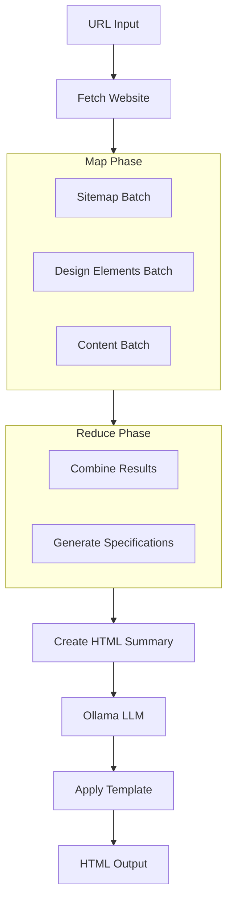
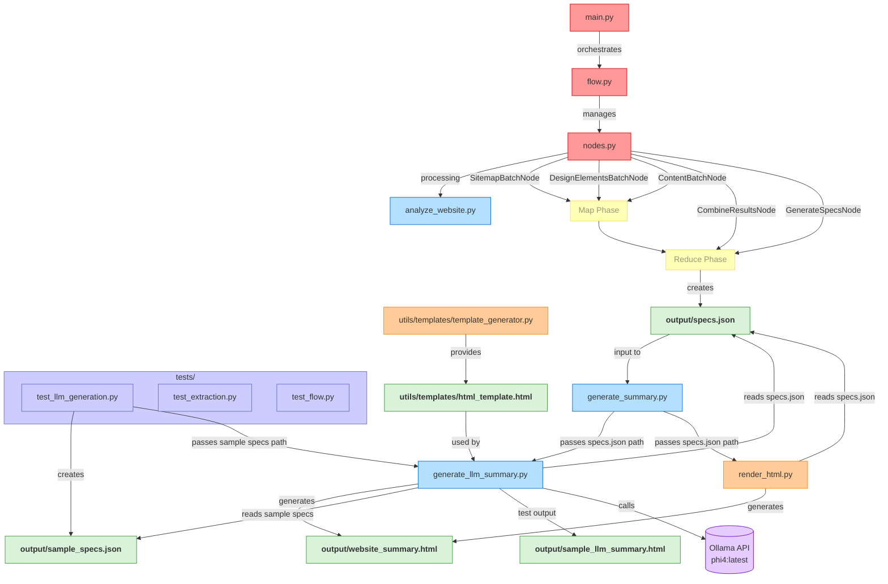

# Website Cloner: Design Document

## 1. Requirements

### Problem Statement
Many businesses and developers need to analyze existing websites to understand their structure, design patterns, and business communication approach. This understanding helps in creating similar or competitive websites and understanding market positioning.

### User Needs
- Analyze a website's structure and content
- Extract design elements like colors and typography
- Understand the business type and positioning
- Create a comprehensive brand and business specification
- Visualize the gathered information in a readable format

### Project Scope
The Website Cloner will:
1. Accept a URL input
2. Crawl and analyze the website's structure (sitemap)
3. Extract content (text, colors, design elements, business type)
4. Generate business and brand specification documents
5. Create a visual HTML summary using Ollama (phi4:latest model)

### Success Criteria
- Successfully extract website content from 90% of common websites
- Identify key design elements with 80% accuracy
- Generate useful business and brand specifications
- Create a visually appealing summary page

## 2. Flow Design

The overall flow follows a Map-Reduce design pattern to efficiently process website topics:





### Map-Reduce Pattern Implementation

The Map-Reduce pattern will be implemented as follows:

1. **Map Phase**:
   - Each topic (sitemap, design elements, content) is processed in parallel using batch processing
   - For each topic, a BatchNode will process one page at a time
   - This approach allows for efficient processing of larger websites with many pages

2. **Reduce Phase**:
   - Results from individual page processing are combined
   - Combined data is used to generate comprehensive specifications
   - Final specifications reflect the entire website rather than individual pages

## 3. Batch Processing Nodes

### SitemapBatchNode
- **Purpose**: Process each page to build a complete sitemap
- **Input**: List of discovered URLs
- **Processing**: Extract page structure and links from each URL
- **Output**: Complete sitemap with all pages and their structure

### DesignElementsBatchNode
- **Purpose**: Process each page to extract design elements
- **Input**: List of pages from sitemap
- **Processing**: Extract colors, fonts, and layout from each page
- **Output**: Aggregated design elements data with frequency information

### ContentBatchNode
- **Purpose**: Process each page to extract content
- **Input**: List of pages from sitemap
- **Processing**: Extract text, business info, and page purpose from each page
- **Output**: Combined content data from all pages

## 4. Utilities

### External API Dependencies
1. **Ollama API**: For generating business and brand specifications and HTML summaries
   - Default Model: phi4:latest
   - Input: Website content and design elements
   - Output: Structured JSON specifications and HTML summary
   - Endpoint: http://localhost:11434/api/generate

### Key Utility Functions
1. **get_website_content** (`utils/get_website_content.py`)
   - Input: URL string
   - Output: BeautifulSoup object, status code, error (if any)
   - Necessity: Core functionality to retrieve website HTML

2. **build_sitemap** (`utils/build_sitemap.py`)
   - Input: Starting URL, max pages to crawl
   - Output: Dictionary with site structure
   - Necessity: Required to understand website organization

3. **extract_design_elements** (`utils/extract_design_elements.py`)
   - Input: BeautifulSoup object, URL
   - Output: Dictionary of design elements (colors, fonts, etc.)
   - Necessity: Required for brand specification

4. **extract_content** (`utils/extract_content.py`)
   - Input: BeautifulSoup object, URL
   - Output: Dictionary of content (text, business info, etc.)
   - Necessity: Required for business specification

5. **generate_specs** (`utils/generate_specs.py`)
   - Input: Content data, design data, sitemap data
   - Output: Business and brand specifications (JSON)
   - Necessity: Core analysis functionality

6. **generate_html_from_specs** (`generate_llm_summary.py`)
   - Input: Specs JSON file path, Output HTML file path
   - Process: Sends specifications to Ollama LLM with HTML template
   - Output: Complete HTML summary
   - Necessity: Core visualization functionality

7. **render_html** (`render_html.py`)
   - Input: Specs JSON file path, Output HTML file path
   - Process: Template-based HTML generation (fallback method)
   - Output: HTML summary
   - Necessity: Fallback if LLM generation fails

8. **get_template** (`utils/templates/template_generator.py`)
   - Input: Optional template path
   - Output: HTML template string
   - Necessity: Provides structure for LLM-generated HTML

## 5. Data Structure Design

### Shared Store
The data will flow through the application in a shared dictionary structure:

```
shared = {
    "url": "https://example.com",
    "soup": BeautifulSoup object,
    "pages_to_process": [
        "https://example.com",
        "https://example.com/about",
        ...
    ],
    "sitemap": {
        "base_url": "https://example.com",
        "pages": {
            "/": {
                "title": "Home",
                "headers": {...},
                "paragraphs_count": 10,
                "links": [...]
            },
            "/about": {...}
        }
    },
    "design": {
        "colors": {"#hexcode": count, ...},
        "fonts": ["font1", "font2", ...],
        "layout": {
            "sections": 5,
            "columns": true,
            "responsive": true
        },
        "images": {
            "count": 15,
            "types": {"jpg": 10, "png": 5}
        },
        "pages_data": {
            "/": {
                "colors": {...},
                "fonts": [...],
                ...
            },
            "/about": {
                ...
            }
        }
    },
    "content": {
        "page_title": "Example Website",
        "main_content": {
            "header": [...],
            "main": [...],
            "footer": [...]
        },
        "business_info": {
            "name": "Example Company",
            "tagline": "Making the web simple",
            "contact": {...},
            "social_media": [...]
        },
        "business_type": {
            "type": "SaaS/Software",
            "confidence": 85
        },
        "word_count": 1500,
        "pages_data": {
            "/": {
                "content": {...},
                "business_info": {...}
            },
            "/about": {
                ...
            }
        }
    },
    "business_spec": {...},
    "brand_spec": {...},
    "html_summary": "<!DOCTYPE html>...",
    "output_path": "/path/to/output.html"
}
```

### Specifications Output (specs.json)
The specifications are stored in JSON format:

```json
{
  "url": "https://example.com",
  "business_spec": {
    "business_overview": {
      "name": "Example Company",
      "type": "SaaS/Software",
      "industry": "Technology"
    },
    "target_audience": {
      "demographics": ["Business professionals", "IT managers"],
      "needs": ["Efficient workflow solutions"],
      "pain_points": ["Time-consuming manual processes"]
    },
    "value_proposition": {
      "problem_solution": "Streamlining business workflows to save time and reduce errors"
    },
    "products_services_offered": {
      "specific_products": [
        {"name": "Product A", "price": "$99/month", "description": "Core service offering"}
      ]
    }
  },
  "brand_spec": {
    "brand_identity": {
      "personality_traits": ["Professional", "Innovative", "Reliable"]
    },
    "color_palette": {
      "primary_colors": [
        {"color": "#4a90e2", "meaning": "Trust and reliability"},
        {"color": "#34495e", "meaning": "Professionalism"}
      ]
    },
    "typography": {
      "fonts": {
        "Helvetica": "Used for headings",
        "Arial": "Used for body text"
      }
    }
  }
}
```

## 6. Implementation Plan

### Phase 1: Core Functionality
1. Implement website content retrieval
2. Implement batch processing for sitemap building
3. Implement batch processing for design element extraction
4. Implement batch processing for content extraction

### Phase 2: Analysis
1. Implement reduce functionality to combine batch results
2. Implement specification generation with Ollama integration

### Phase 3: Visualization
1. Implement Ollama-based HTML summary generation using phi4:latest model
2. Implement template-based HTML generation as fallback
3. Create template management system

### Phase 4: Testing & Optimization
1. Test with various website types
2. Optimize batch processing efficiency
3. Improve extraction accuracy

## 7. HTML Generation Options

### Option 1: LLM-based Generation (Primary)
- Uses Ollama's phi4:latest model to generate HTML
- Advantages:
  - Better handles complex JSON structures
  - Flexible interpretation of data
  - More natural language descriptions
  - Adapts to different data formats
- Implementation:
  1. Load specs.json
  2. Get HTML template
  3. Create prompt with template and specs data
  4. Call Ollama API with prompt
  5. Save generated HTML to file

### Option 2: Template-based Generation (Fallback)
- Uses a predefined template with conditional logic
- Advantages:
  - No external API dependency
  - Faster execution
  - More predictable output
- Implementation:
  1. Load specs.json
  2. Extract key information
  3. Apply template with extracted data
  4. Save generated HTML to file
